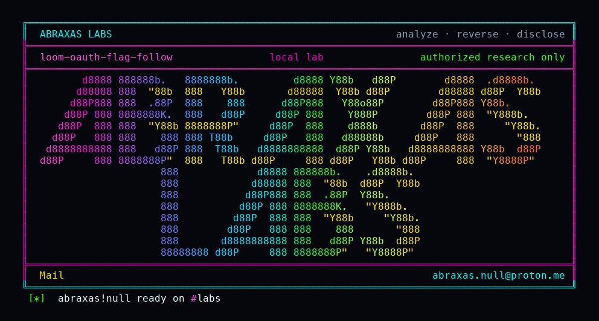

<p align="center">
  
</p>

# loom-oauth-flag-follow

On a connector that was never migrated, moving the URL does not clear the OAuth client secret. A connection test then presents a bearer token, minted with that secret, to the new host. A row that was migrated (`has_oauth2_secret` equal to the string `true`) is cleared, and the control host sees an empty Authorization header.

Same group. The attacker can already edit that connector. Only the unmigrated shape is affected, which is why the score uses high complexity.

**Class:** Secret follows a URL change when a flag is null
**Reach:** Remote. Same-group `mcp:write`. The A2A update uses the same string compare on `base_url`.

**[Loom](https://github.com/awslabs/loom)** [v1.9.0](https://github.com/awslabs/loom/releases/tag/v1.9.0) `a3050669` and [v1.10.3](https://github.com/awslabs/loom/releases/tag/v1.10.3) `cc10ab0`

| | |
|---|---|
| ID | no CVE yet |
| Class | **OAuth client secret follows a URL move when the flag is not `true`** |
| Reach | **Remote**, same group |
| CWE | [CWE-522](https://cwe.mitre.org/data/definitions/522.html) |
| CVSS | **Medium: 6.6** `CVSS:3.1/AV:N/AC:H/PR:H/UI:N/S:C/C:H/I:L/A:N` |
| Product | [awslabs/loom](https://github.com/awslabs/loom) |
| Affected | **v1.9.0** `a3050669f5b4c83210a44ed4346f17e01641e82f` and **v1.10.3** `cc10ab08573087fa12154f7c8181ffcd985fea88`. Unmigrated rows only. |
| Auth | `mcp:write` (`g-admins-demo` in the lab) |
| License | [GNU Affero GPL v3.0](LICENSE) |
| Lab | loopback Docker on v1.9.0. The flag check is unchanged on v1.10.3. |

## What an attacker can do

| Privilege | Method / sink | Impact | Lab-proven or inferred |
|---|---|---|---|
| Leave a null flag and a plaintext secret in place | pre-migration row | Confidentiality, stored | Lab-proven. Flag none, column set. |
| Move `endpoint_url` without clearing it | `PUT /api/mcp/servers/{id}` | Integrity. Flag stays null. | Lab-proven. HTTP 200. |
| Present a bearer token to the new host | `POST .../test-connection` | Confidentiality | Lab-proven. `Bearer` plus the witness on `/mcp`. |
| Do the same on A2A | `PUT` of `base_url` under the same `== "true"` test | Confidentiality | Same predicate in source. The lab was the MCP route. |

**Stays closed**

| Axis | Method / sink | Why it is closed |
|---|---|---|
| Confidentiality | Migrated row, flag `true` | Lab control. Flag becomes `false`, column cleared, control Authorization empty. |
| Confidentiality | Admin API key on a move | Cleared when its own flag is `true`. Different secret. |
| Confidentiality | Metadata and loopback | `guarded_post` still refuses them |

## How I found it

The clear is `has_oauth2_secret == "true"`. In Python that is false for `None`. `resolve_oauth2_client_secret` never reads the flag. If Secrets Manager does not have the new name, it returns the legacy column.

I checked the migrated row in the same run so this would not be "every connector." It is the old rows.

Container on v1.9.0. v1.10.3 still has the string compare in both routers.

## Lab

```bash
python3 loom-oauth-flag-follow-Abraxas-Labs.py
```

```text
SUCCESS LOOM-190-OAUTH-FLAG-FOLLOW unmigrated-follow=yes migrated-cleared=yes LOOM-190-OAUTH-FLAG-FOLLOW-WITNESS
```

## The fix

Treat any stored secret as "present" when the URL changes, not only the string `true`. Delete the legacy column in that branch. Make `resolve_oauth2_client_secret` refuse the column when the flag is not a positive migrate.

## References

- [awslabs/loom v1.10.3](https://github.com/awslabs/loom/releases/tag/v1.10.3) `cc10ab08573087fa12154f7c8181ffcd985fea88`
- [`mcp.py` flag check](https://github.com/awslabs/loom/blob/cc10ab08573087fa12154f7c8181ffcd985fea88/backend/app/routers/mcp.py#L422)
- [`a2a.py` flag check](https://github.com/awslabs/loom/blob/cc10ab08573087fa12154f7c8181ffcd985fea88/backend/app/routers/a2a.py#L316)
- [`resolve_oauth2_client_secret`](https://github.com/awslabs/loom/blob/cc10ab08573087fa12154f7c8181ffcd985fea88/backend/app/services/mcp.py#L67)
- [CWE-522](https://cwe.mitre.org/data/definitions/522.html)
- [CVSS 3.1 calculator](https://www.first.org/cvss/calculator/3.1#CVSS:3.1/AV:N/AC:H/PR:H/UI:N/S:C/C:H/I:L/A:N)


## License

GNU Affero GPL v3.0. See [LICENSE](LICENSE). Loopback lab only. No warranty.

Abraxas Labs
abraxas.null@proton.me
